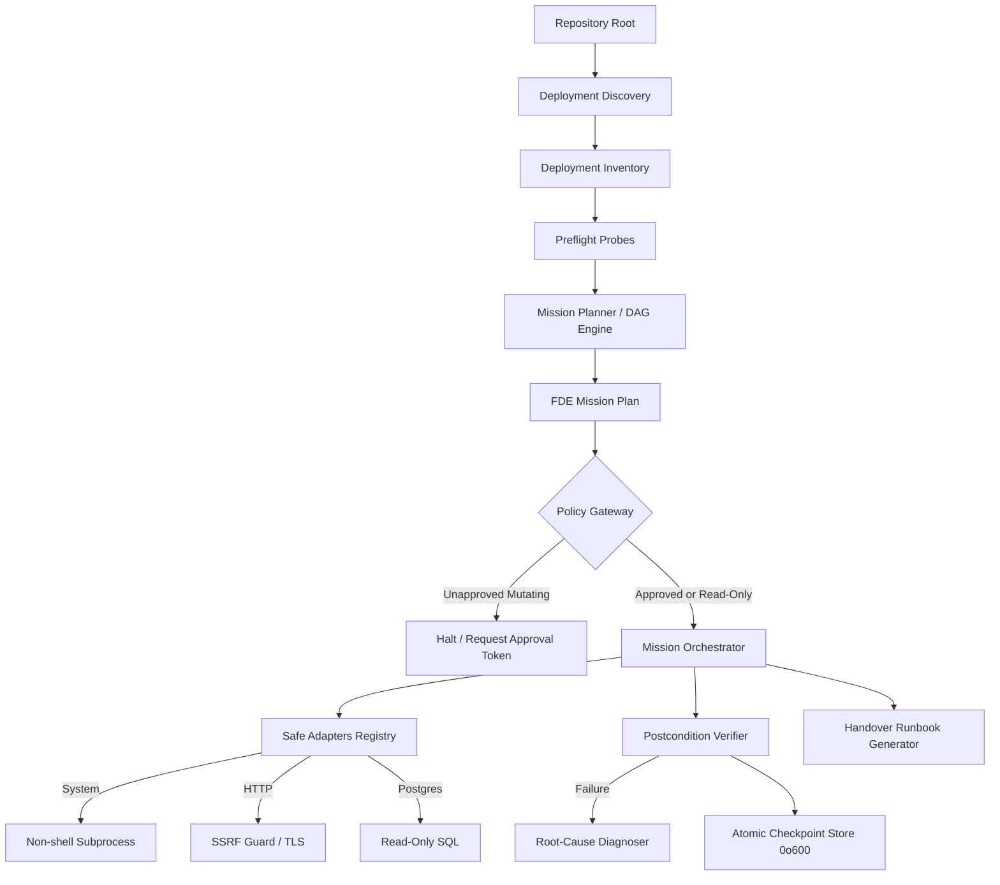

# FDE Architecture & Security Model

## Architectural Overview

LogicFalcon's Forward Deployment Engineering (FDE) subsystem is designed around deterministic execution, least privilege, and strict boundary enforcement.

---

## 1. Safety Boundaries & Security Invariants

### 1.1 Non-Shell Subprocess Execution
All OS commands invoked by `SystemAdapter` use direct `subprocess.Popen` or `subprocess.run` with argument vectors (`list[str]`). Shell execution (`shell=True`) is strictly prohibited, eliminating arbitrary shell interpolation and command injection risks.

### 1.2 SSRF Protection & Network Isolation
The `HttpAdapter` intercepts all outbound requests and evaluates destination IPs against private, loopback, and cloud metadata ranges before opening a socket:
- Blocks AWS/GCP/Azure link-local metadata addresses (`169.254.169.254`, `169.254.170.2`).
- Blocks IPv4 and IPv6 loopback (`127.0.0.0/8`, `::1`) unless local test mode is explicitly enabled.
- Blocks RFC 1918 private subnets (`10.0.0.0/8`, `172.16.0.0/12`, `192.168.0.0/16`) in untrusted contexts.
- Enforces strict TLS certificate verification.
- Caps request and response sizes to 512 KB to prevent denial of service through memory exhaustion.

### 1.3 Cryptographic Approval Token Architecture
Operations classified as `EXTERNAL_MUTATING` or `DANGEROUS` require an approval token.
- Tokens are generated as `HMAC-SHA256(secret, mission_id:operation:params_hash:timestamp)`.
- Replaying a token against a different mission, altered parameters, or after expiry fails immediately.
- Approvals cannot be bypassed by external integrations or downstream adapters.

### 1.4 Atomic Persistence & Recursive Credential Redaction
All mission state checkpoints and runbooks undergo multi-pass credential scrubbing:
- Passwords, API tokens, AWS keys (`AKIA...`), GitHub PATs (`ghp_...`), and connection URIs are scrubbed.
- Checkpoints are written to a `.tmp` file and atomically renamed with POSIX `0o600` file permissions (owner read/write only).

---

## 2. State Machine & Execution Lifecycle

Mission execution progresses through explicit states:

1. **`PENDING`**: Mission created; preflight and validation not yet started.
2. **`PREFLIGHT`**: Environment and runtime probes executing.
3. **`APPROVED`**: Policy evaluation complete; cryptographic approval token verified.
4. **`EXECUTING`**: Topological execution of steps in the mission DAG.
5. **`COMPLETED`**: All steps executed and postconditions verified.
6. **`FAILED`**: Step failed or postcondition assertion violated. Triggers failure diagnosis.
7. **`CANCELLED`**: Mission aborted before completion.

---

## 3. Postcondition Verification & Failure Diagnosis

Postconditions are declarative assertions evaluated after step completion:
- `http_status`: Verifies expected HTTP status code (e.g. `200`, `201`).
- `json_field`: Verifies presence and exact value of keys in JSON responses.
- `port_bound`: Confirms TCP port is actively accepting connections.

When an assertion fails, the `FailureDiagnoser`:
1. Collects step error output, return code, and verification results.
2. Matches against deterministic failure rule signatures (e.g., `PORT_CONFLICT`, `CONNECTION_REFUSED`, `AUTH_FAILURE`).
3. Produces ranked hypotheses with confidence scores (`0.0` to `1.0`) and actionable remediations.
